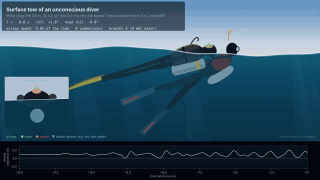
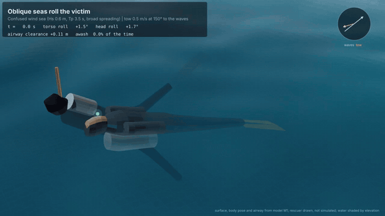
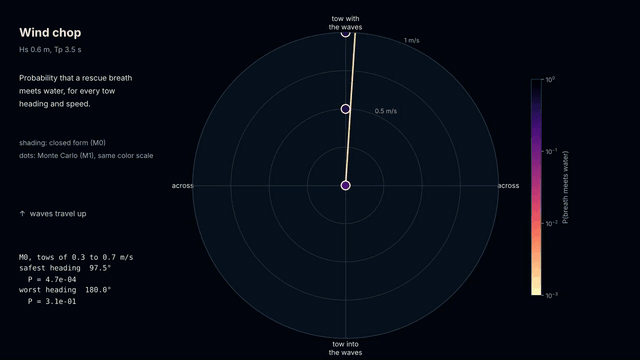
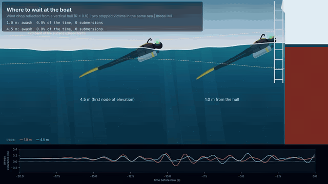
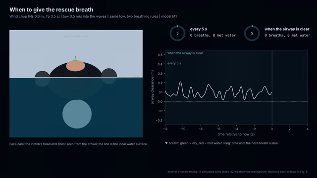

# Rescue Tow Airway

[](https://www.python.org/)
[](LICENSE)
[](https://numpy.org/)
[](https://scipy.org/)
[](https://matplotlib.org/)


Supplementary code for the manuscript

> **Airway submersion during the surface tow of an unconscious scuba diver: a stochastic strip-theory model in idealized seas**
> Sandy H. S. Herho, Raden Dwi Susanto, Sito F. Biosa, Rusmawan Suwarman, and Dasapta E. Irawan

After an unconscious diver is brought to the surface, the rescuer must keep the airway out of the water while towing and giving rescue breaths. Rescue training treats this as a matter of technique. This repository treats it as a problem in wave mechanics: the victim is a floating body forced by random waves and towed by the rescuer, and the quantity of interest is the height of the mouth and nose above the local water surface. Every rescue question (which way to tow, how fast, how much air to put in the BCD, when to give a breath, where to wait at the boat) becomes a question about the statistics of that one signal.

The model is idealized. It uses no observational data, and no number in it is an estimate for a particular person, site, or sea.



## The model in brief

The victim floats supine and is towed head first. The body, cylinder and BCD bladder are stacks of elliptical cross sections (strip theory, often called 2.5D): each section feels buoyancy and the Froude-Krylov force on its exact submerged area below the local, sloping free surface, together with added mass, radiation damping and quadratic drag on its velocity relative to the water. The generalized coordinates are heave, pitch, torso roll and the roll of the head about the neck,

```
q = (zeta, theta, phi, chi),     M(q) q'' = Q(q, q', eta, w, a, s),
```

where `eta, w, a, s` are the surface elevation, vertical particle velocity and acceleration, and cross-body slope at each strip. The airway clearance is

```
r(t) = z_airway(q) - [eta + s y]_airway - h0 ,
```

and the airway is awash whenever `r < 0`. Two models share the same force routine:

* **M1** integrates the nonlinear equations (fourth-order Runge-Kutta) in random seas built from plane waves, with Monte Carlo over realizations.
* **M0** is the exact linearization of M1 about the floating equilibrium, with the quadratic drag replaced by its statistically equivalent linear form. A towed body meets each wave at the encounter frequency `omega_e = omega - k . V`, and the linear response gives the airway statistics in closed form (Rice):

```
P(awash)  = Phi(-mu / sigma_r)
nu        = sigma_rdot / (2 pi sigma_r) exp(-mu^2 / (2 sigma_r^2))      submersions per second
P(breath) = P + (1 - P) (1 - exp(-nu tau / (1 - P)))                   a breath of length tau meets water
```

All sea states are superpositions of plane waves: JONSWAP spectra with cos^2s spreading, waves on a uniform current (wave-action conservation, with blocking), shoaling to finite depth with depth-limited saturation, and partial reflection from a vertical hull.

## Environments

| Code | Setting | Waves |
|---|---|---|
| E1 | Open-ocean swell | Hs 1.0 m, Tp 12 s, long-crested |
| E2 | Wind chop | Hs 0.6 m, Tp 3.5 s, moderate spreading |
| E3 | Mixed sea | 0.8 m, 11 s swell crossed at 60 deg by a 0.5 m, 4 s wind sea |
| E4 | Tidal current | Hs 0.5 m, Tp 4 s sea entering a 0.75 m/s current, opposing (E4-) or following (E4+) |
| E5 | Beach exit | 0.8 m, 9 s swell shoaling from 30 m to 2 m depth |
| E6 | Boat hull | the wind chop reflected from a vertical hull (R = 0.9) |
| E7 | Confused sea | the wind chop with broad directional spreading |

The default rescue configuration is a jacket BCD with 12 L of air, the weight belt removed, the head tilted back to open the airway but otherwise unsupported, a tow at the BCD shoulder strap, and a 1 s rescue breath every 5 s.

## Main results

All numbers below come from `outputs/reports/results.txt`. "Breath risk" is the probability that a 1 s rescue breath given every 5 s meets water. M1 values come from 12 to 32 simulated tows of 200 to 300 s each.

| Result | Where |
|---|---|
| M1 reproduces its own linearization: at Hs 0.05 m the airway clearance standard deviations agree within 2.3%, and the integration converges at fourth order in the time step | `compute_verification.py`, Fig. 2 |
| Linear theory underestimates exposure when towing with the waves: at Hs 0.6 m, M1 gives 49% more clearance fluctuation than M0 and 3.7 times the time awash (14.2% against 3.8%) | Fig. 2 |
| In the wind chop at 0.5 m/s, breath risk is 0.41 towing with the waves, 0.22 into them, and 0.025 across them (M1) | `compute_riskmaps_*.py`, Figs. 3, 4, 9 |
| Across the wind chop beats into it in all 400 random sets of the uncertain hydrodynamic coefficients | `compute_sensitivity.py`, Fig. 8 |
| The safest heading depends on the sea: in the confused sea (E7) towing into the waves is safest (0.10, against 0.16 across and 0.39 with them); in the mixed sea (E3) towing into the swell gives no failed breaths at 0.5 m/s | Figs. 3, 9 |
| Faster is not safer: in the wind chop, towing into the waves at 1.0 m/s doubles the breath risk of 0.5 m/s (0.51 against 0.22) | Fig. 4 |
| Waves steepened by an opposing 0.75 m/s current are the most dangerous setting: at 0.5 m/s breath risk is 0.82 into the waves, 0.89 with them, and 0.46 across them; in some tows the model victim rolled over completely (stopped across the waves, and towed with them) | Figs. 3, 9 |
| Long swell, waves on a following current, and a shoaling swell on the way to the beach gave no awash events in the simulated tows and negligible closed-form risk | Figs. 3, 7 |
| A jacket BCD rights the victim from a roll; with the same air in a back-inflation wing, the victim rolls face down in still water | `compute_statics.py`, Fig. 1 |
| More BCD air raised the risk towing into the chop (0.14 at 8 L, 0.24 at 12 L, 0.35 at 20 L, M1): a fuller BCD floats the body flatter, and a flat body pitches more. Towing across the waves, the risk stayed below 0.013 at every volume | `compute_buoyancy.py`, Fig. 5 |
| Waiting until the airway is clear and rising before each breath cut failed breaths by 35 to 60% in wind chop and confused seas; waiting for a crest to pass did not help consistently | `compute_breathing.py`, Figs. 6, 9 |
| The gain from waiting grows with how predictable the dry spells are, measured as the information (0.3 to 1.0 bits) separating them from a memoryless sequence | Fig. 6 |
| Stopped at a boat with the head toward the hull and the waves arriving from the feet, breath risk was 0.33 to 0.37 at every distance from 1 to 6 m; lying alongside the hull, it was below 1 in 10,000 | `compute_environments.py`, Fig. 7 |

## What this may mean for divers

These are results of an idealized model, not tested rescue procedures. They are offered as hypotheses for instructors and rescue divers to examine in training, not as replacements for agency standards.

* **Look at the waves before choosing a direction to tow.** In a short wind chop, the model keeps the airway clearest when the tow runs along the wave crests (across the waves), and worst when the waves overtake the victim from behind. In a confused or crossed sea the best direction changes, so no single rule covers every sea.
* **Do not tow faster than needed.** Going from 0.5 to 1.0 m/s doubled the risk in the model.
* **Avoid towing through waves standing up against a current**, such as at the mouth of a tidal channel or a strait at mid-tide. If possible, wait for slack water or take a route out of the current.
* **Wait for the face to clear, then breathe.** Breathing on a fixed count sends some breaths into water. Waiting at most a few seconds until the mouth and nose are visibly clear and rising roughly halved the failures in several seas, while keeping breaths about every 5.2 s on average.
* **A jacket BCD helps keep an unconscious victim face up.** In the model, back-inflation wings rolled the victim face down. Rescuers should be ready to hold a wing-equipped victim face up.
* **Do not assume that more air in the BCD is always better.** Enough air to float the victim securely is essential, but when towing into the waves the model gave lower risk with moderate inflation than with a full bladder.
* **At the boat, hold the victim alongside the hull rather than head-on to it** while waiting for help to lift them, so that the reflected waves run along the body instead of over the face.

## Repository layout

```
rescue_tow_airway/
├── rescue_tow_airway/          # the library
│   ├── waves.py                # spectra, currents, shoaling, hull reflection, kinematics
│   ├── body.py                 # the diver, BCD, cylinder, rescue configuration
│   ├── dynamics.py             # M1: strip forces, mass matrix, equilibrium, RK4
│   ├── linear.py               # M0: exact linearization and Rice statistics
│   ├── montecarlo.py           # Monte Carlo driver
│   ├── breathing.py            # rescue-breath timing strategies
│   ├── diagnostics.py          # events, Fano factor, information, GEV, Sobol
│   ├── environments.py         # E1 to E7
│   ├── diver_art.py            # diver drawings built from the model geometry
│   ├── render3d.py             # small renderer for the oblique view
│   ├── anim_style.py           # animation scenes and encoding
│   ├── plotting.py             # figure style
│   └── io.py                   # output paths, cache, CSV, reports
├── scripts/
│   ├── compute_*.py            # simulations (results cached as .npz)
│   ├── fig01_model.py ... fig09_decision.py
│   ├── anim01_tow.py ... anim05_breathing.py
│   ├── make_reports.py         # every number quoted from the simulations
│   └── run_all.py              # the whole pipeline
└── outputs/
    ├── figures/                # PDF and 600 dpi PNG
    ├── animations/             # MP4 and GIF
    ├── data/                   # CSV behind each figure panel
    └── reports/                # plain-text reports
```

## Installation

Python 3.9 or later.

```bash
git clone https://github.com/sandyherho/rescue_tow_airway.git
cd rescue_tow_airway
pip install -e .
```

The library depends only on NumPy, SciPy, Matplotlib and Pillow. The animations also need FFmpeg on the system path.

## Reproducing the results

```bash
python scripts/run_all.py            # simulations, figures, reports, animations
python scripts/run_all.py --no-anim  # skip the animations
```

The full pipeline takes a few hours on a two-core laptop, most of it in the Monte Carlo runs. Each script can also be run on its own; the figure and report scripts read the cached results in `outputs/cache/`. All random seeds are fixed.

A minimal example:

```python
import numpy as np
from rescue_tow_airway.body import build_body
from rescue_tow_airway.environments import e2_chop
from rescue_tow_airway.linear import LinearModel

body = build_body()                    # jacket BCD, 12 L, collar tow
model = LinearModel(body, speed=0.5)   # M0 at 0.5 m/s
grid = e2_chop().spectral_grid()
for heading in (0, 90, 180):           # with, across, into the waves
    st = model.response(grid, np.radians(heading))
    print(heading, round(st.p_awash, 4), round(st.p_breath, 4))
```

## Figures

| | |
|---|---|
| `fig01_model` | The strip model, floating equilibrium, natural modes, roll release of jacket and wing BCDs |
| `fig02_verification` | M1 against its linearization M0, the airway transfer function, time-step convergence |
| `fig03_riskmaps` | Breath failure risk over tow speed and heading: (a) E1, (b) E2, (c) E3, (d) E7, (e) E4-, (f) E4+ |
| `fig04_heading` | Heading and speed dependence, encounter period |
| `fig05_buoyancy` | BCD air, tow point and head support |
| `fig06_breathing` | Breath timing strategies, Fano factor, timing information, longest immersion |
| `fig07_coastal` | Beach exit and waiting at a boat hull |
| `fig08_sensitivity` | Sobol indices of the uncertain hydrodynamic coefficients |
| `fig09_decision` | A decision chart for rescuers |

## Animations

**Oblique seas roll the victim.** A confused sea, towed at 150 deg to the waves; the unsupported head rolls further than the torso.



**A radar sweep over every tow heading and speed.** Closed-form risk with Monte Carlo checks, environment by environment.



**Where to wait at the boat.** Two stopped victims in the same reflected sea, one near the hull and one at the first node of the surface variance.



**When to give the rescue breath.** One tow, two breathing rules: every 5 s, or when the airway is clear and rising.



The rescuer in the animations is drawn for context and is not simulated. Light shafts, particles and sky are decorative; the water surface, the victim's pose and the airway status come from the model.

## Limitations

* The waves are linear (Gaussian). Breaking waves, spray and wave-crest asymmetry are not modeled, so surf zones and whitecaps are outside the scope of the study; the beach-exit result applies only before the waves break.
* The body is rigid apart from the neck, and its hydrodynamic coefficients (added mass, radiation damping, drag) come from simple section formulas rather than measurements of floating divers. The Sobol analysis treats them as uncertain over wide ranges; the Sobol estimates carry sampling error of roughly 0.1 to 0.2 at the base sample size used.
* Strip theory assumes a slender body. Trims steeper than about 25 deg, which occur with little BCD air or with the valve tow, are where the model is least reliable.
* Surge is prescribed by the tow, and sway and yaw are held by the rescuer. The rescuer is not simulated, and the drawing in the animations carries no physics.
* Hull reflection uses a straight vertical wall with a constant reflection coefficient; real hulls are finite, curved and move.
* Head support (a stiffer neck) changed the results very little, because the airway lies close to the head's roll axis. A model of the head nodding forward, which is not included, may behave differently.
* No result here has been tested against measurements. The study is a set of hypotheses for experiments in pools and wave tanks, and for discussion in rescue training.

## Citation

If you use this code, please cite the manuscript and this repository (see `CITATION.cff`).

## Acknowledgments

This work was supported by the Faculty of Earth Sciences and Technology (FITB), Bandung Institute of Technology (ITB), through the PPMI Research Program 2026 (Project ID FITB.PPMI-1-19-2026). We are especially grateful to Andini Alifah (SSI PRO 124122, Mazu Divers) for instruction in the rescue diver course, whose emphasis on keeping a victim's airway clear while towing and ventilating at the surface motivated this study. We thank Jemi Godjali (INA.F00.B3.0091, POSSI Board of Instructors), Mat Ningrum (INA.F00.B1.0375, Instrument Dive Adventure), Saep Saepudin (INA.F00.B1.0396, Indonesian Navy), and Subagiyo (INA.F00.B1.0412, Indonesian Navy) for their guidance, support, and expertise in basic and advanced scuba diving training.

## License

MIT License. Copyright (c) 2026 Applied Geology Research Group, Bandung Institute of Technology.
